# Evaluación Parcial N°2 - Infraestructura Serverless (35%)
**Asignatura:** Infraestructura de Aplicaciones II (INY1106)  
**Institución:** Duoc UC - Escuela de Informática y Telecomunicaciones  
**Ambiente:** AWS Academy Learner Lab (Región: `us-east-1`, Account ID: `286823679176`)  
**Proyecto:** *Image Metadata API*  

---

## 1. Descripción General y Arquitectura de la Solución

El presente proyecto consiste en el diseño, aprovisionamiento, despliegue y validación de una arquitectura Serverless en Amazon Web Services (AWS) para el servicio **Image Metadata API**. La infraestructura permite a usuarios subir imágenes en formato JPEG/JPG a través de un API REST, almacenar los binarios en un bucket escalable de Amazon S3, persistir sus metadatos de forma atómica en Amazon DynamoDB y consultar dichos metadatos en milisegundos mediante identificadores únicos (`image_id`).

### Diagrama de Arquitectura
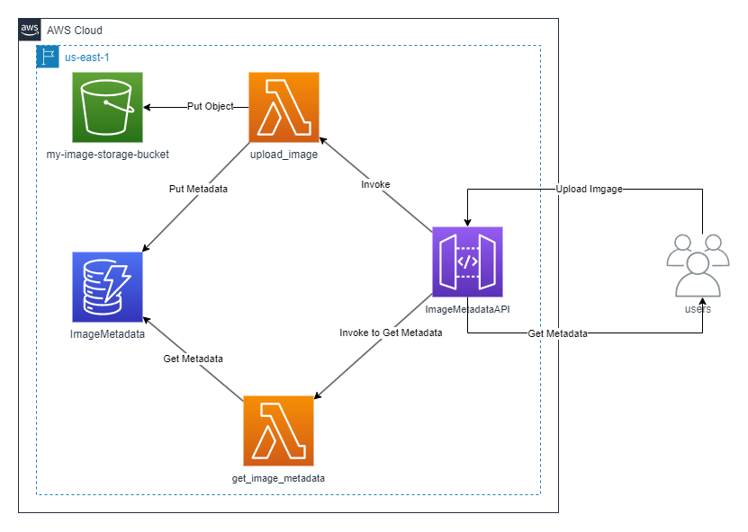

### Flujo de Datos
1. **Subida de Imagen (`POST /upload`)**:
   - El cliente envía la imagen codificada a través de Amazon API Gateway (`ImageMetadataAPI`).
   - API Gateway invoca mediante integración Proxy a la función AWS Lambda `upload_image`.
   - La función genera un identificador alfanumérico único (`uuid4` sanitizado), almacena el archivo en el bucket S3 `my-image-storage-bucket-286823679176`, calcula el tamaño y URL pública, y registra el ítem en la tabla DynamoDB `ImageMetadata`.
   - Retorna código HTTP `200` con el mensaje de éxito y la URL del objeto.
2. **Consulta de Metadatos (`GET /metadata/{image_id}`)**:
   - El cliente realiza una solicitud `GET` parametrizada por URL con el ID de la imagen.
   - API Gateway enruta la petición a la función Lambda `get_image_metadata`.
   - La función consulta la clave primaria `image_id` en la tabla DynamoDB `ImageMetadata`.
   - Retorna código HTTP `200` con el objeto JSON que contiene `image_id`, `size` y `url`.

---

## 2. Indicador IE2.2.1: Creación del Bucket Amazon S3 (10%)

### Requisitos y Configuración
* **Nomenclatura solicitada:** Debe iniciar con `my-image-storage-bucket`.
* **Nombre implementado:** `my-image-storage-bucket-286823679176` (incorporando el ID de cuenta para garantizar unicidad global requerida por DNS en S3).
* **Región:** `us-east-1` (US East - N. Virginia).
* **Propósito:** Almacenamiento persistente, seguro y de alta durabilidad (99.999999999% de durabilidad) para las imágenes subidas por los usuarios.

### Evidencia de Configuración y Objetos Almacenados
Se evidencia el bucket creado en la consola de AWS S3 junto al archivo de imagen subido durante las pruebas de integración (`80adf0c1485c4983a0941538b6ca17da.jpg`):

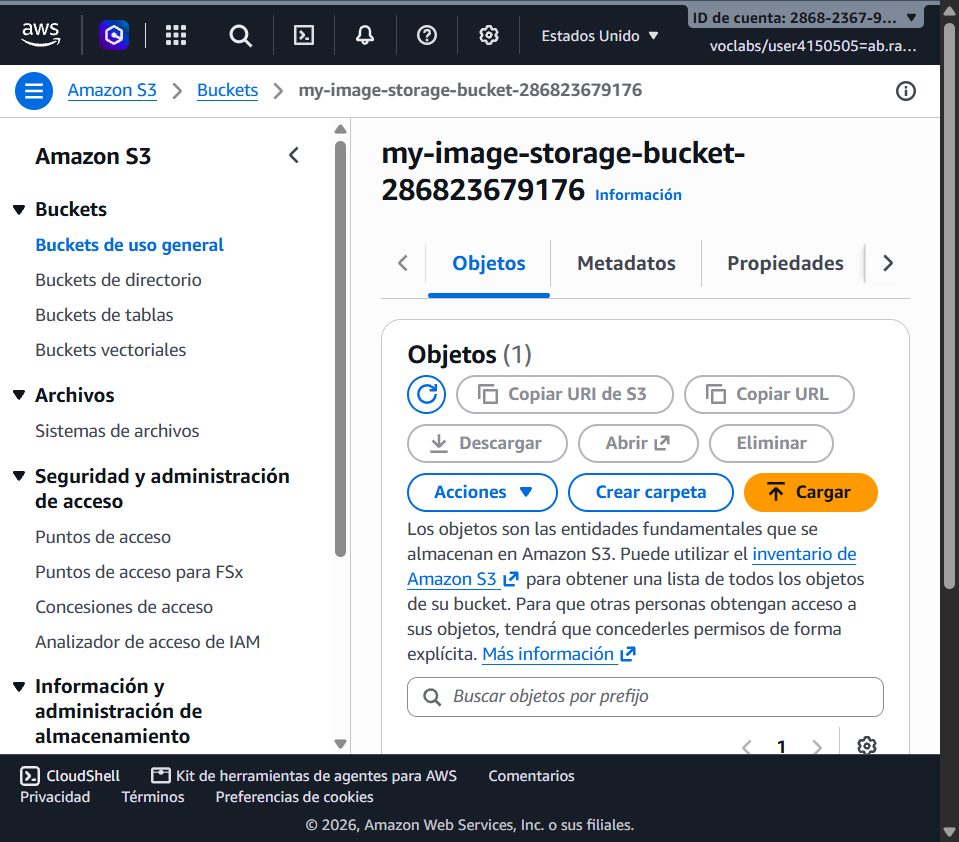

---

## 3. Indicador IE2.2.2: Creación de la Tabla Amazon DynamoDB (10%)

### Requisitos y Configuración
* **Nombre de la tabla:** `ImageMetadata`
* **Clave de partición (Partition Key):** `image_id` (Tipo: `String` / `S`).
* **Modo de capacidad:** `On-Demand (PAY_PER_REQUEST)` para garantizar auto-escalabilidad inmediata sin aprovisionamiento estático y reducción de costos en reposo.
* **Cifrado en reposo:** Administrado por AWS KMS (Default).

### Evidencia de la Tabla y Registro de Metadatos
Se muestra la tabla creada en la consola de DynamoDB y el explorador de elementos donde se aprecia el registro insertado con los atributos `image_id`, `url` y `size`:

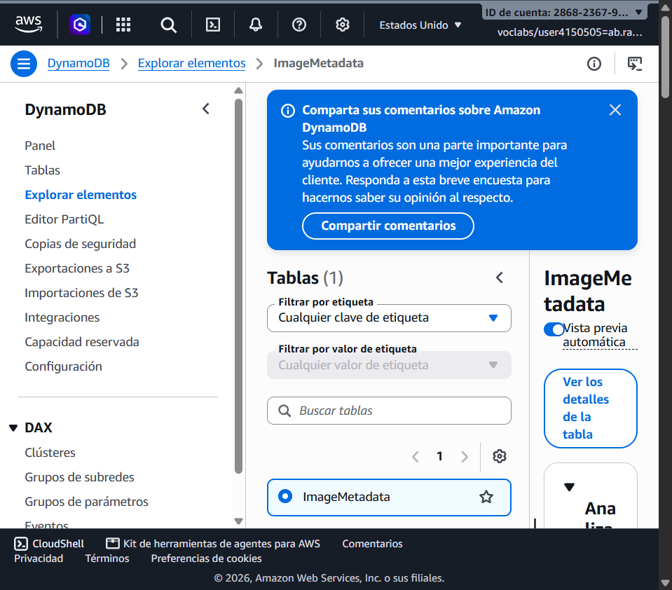

---

## 4. Indicador IE2.1.1: Despliegue de Funciones AWS Lambda (30%)

Se implementaron dos funciones serverless desacopladas en tiempo de ejecución **Python 3.12**, asociadas al rol de ejecución seguro `LabRole` provisto por el laboratorio de AWS Academy.

### 4.1 Función 1: `upload_image`
* **Nombre:** `upload_image`
* **Runtime:** Python 3.12 (Arquitectura x86_64).
* **Handler:** `upload_image.upload_image`
* **Timeout:** `30 segundos`
* **Memoria:** 128 MB
* **Rol IAM:** `arn:aws:iam::286823679176:role/LabRole`
* **Variables de Entorno:**
  * `BUCKET_NAME`: `my-image-storage-bucket-286823679176`
  * `TABLE_NAME`: `ImageMetadata`

#### Evidencia de Código y Configuración de `upload_image`:
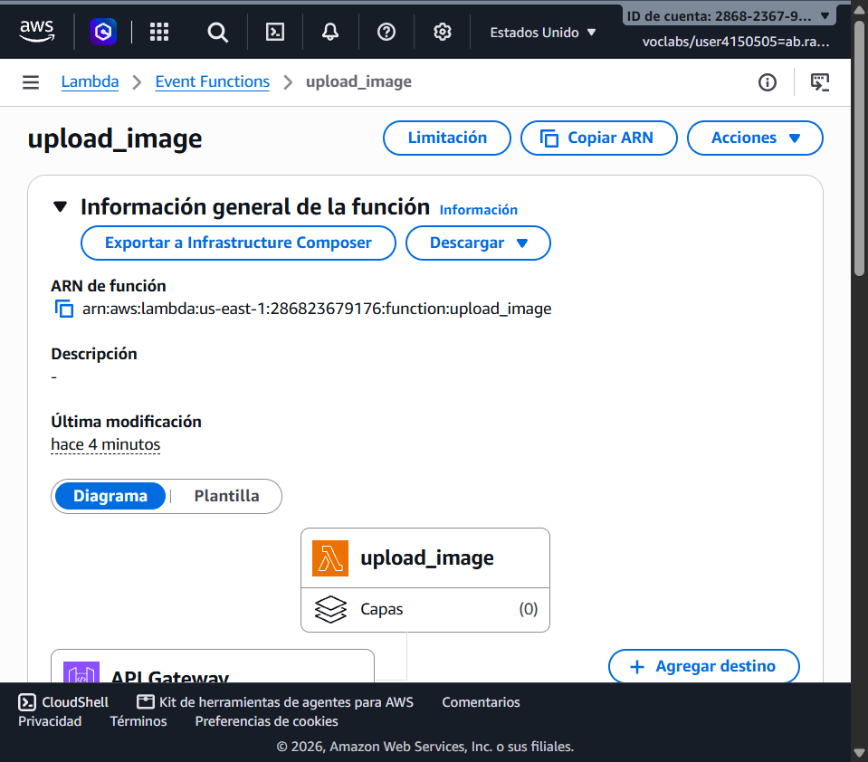
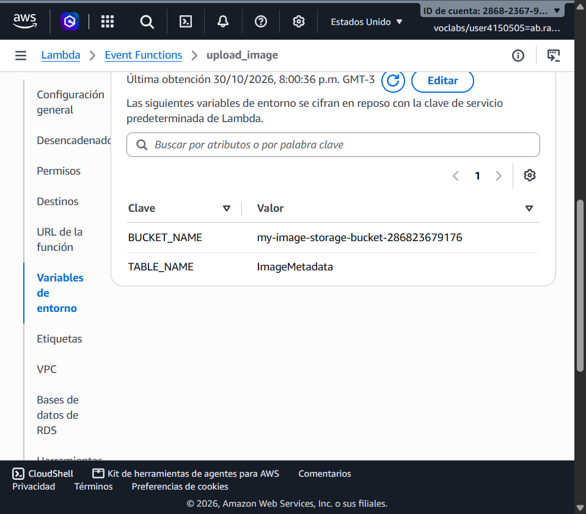

---

### 4.2 Función 2: `get_image_metadata`
* **Nombre:** `get_image_metadata`
* **Runtime:** Python 3.12 (Arquitectura x86_64).
* **Handler:** `get_image_metadata.get_image_metadata`
* **Timeout:** `30 segundos`
* **Memoria:** 128 MB
* **Rol IAM:** `arn:aws:iam::286823679176:role/LabRole`
* **Variables de Entorno:**
  * `TABLE_NAME`: `ImageMetadata`

#### Evidencia de Código y Configuración de `get_image_metadata`:
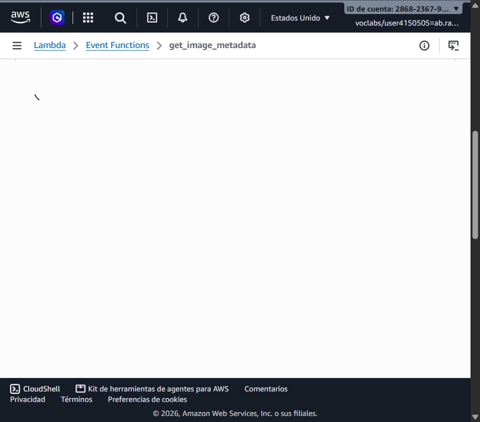

---

## 5. Indicador IE2.2.3: Configuración de AWS API Gateway (15%)

Se configuró un API de tipo **REST API** denominado `ImageMetadataAPI` para exponer los servicios de manera desacoplada y escalable.

### Parámetros del API
* **Nombre:** `ImageMetadataAPI`
* **ID:** `er6bwcycph`
* **Stage desplegado:** `prod`
* **Base URL:** `https://er6bwcycph.execute-api.us-east-1.amazonaws.com/prod`

### Endpoints y Métodos
1. **Endpoint `POST /upload`**:
   * **Tipo de Integración:** Lambda Proxy Integration.
   * **Función Destino:** `arn:aws:lambda:us-east-1:286823679176:function:upload_image`.
   * **Permisos:** Política de recurso Lambda invocable por API Gateway (`lambda:InvokeFunction`).
2. **Endpoint `GET /metadata/{image_id}`**:
   * **Tipo de Integración:** Lambda Proxy Integration.
   * **Función Destino:** `arn:aws:lambda:us-east-1:286823679176:function:get_image_metadata`.
   * **Parámetro de ruta:** `{image_id}` obligatorio y propagado en `pathParameters`.

#### Evidencia de Recursos y Métodos en API Gateway:
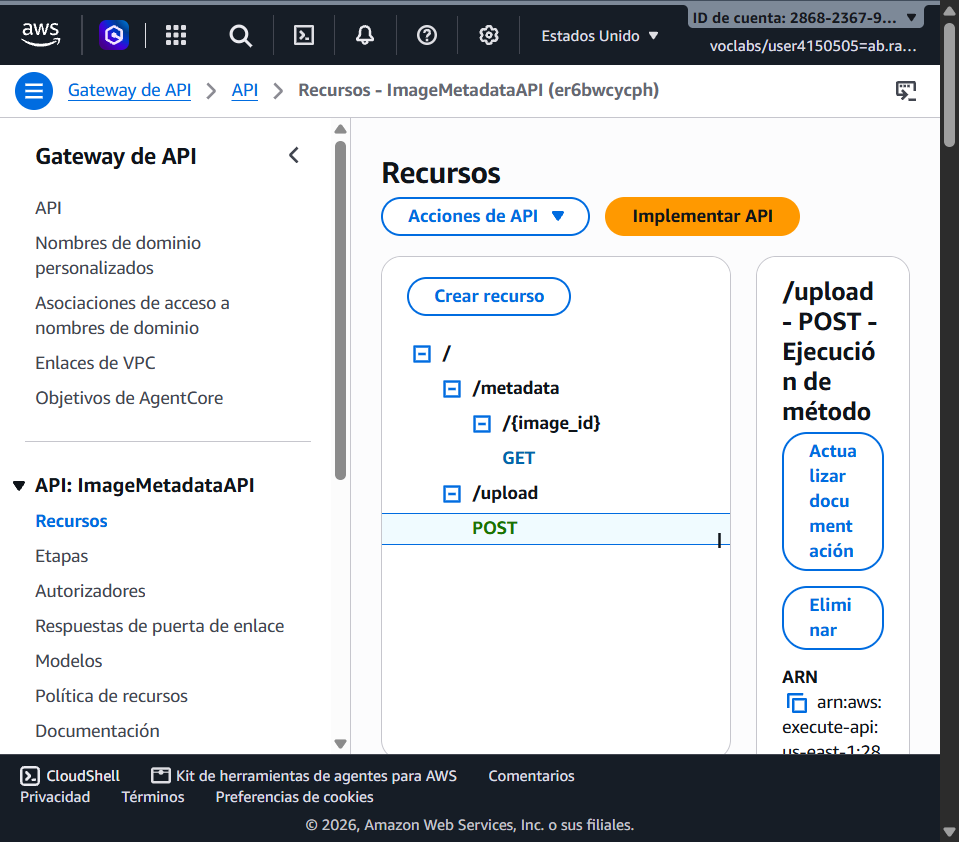

#### Evidencia del Stage `prod` y URL de Invocación:
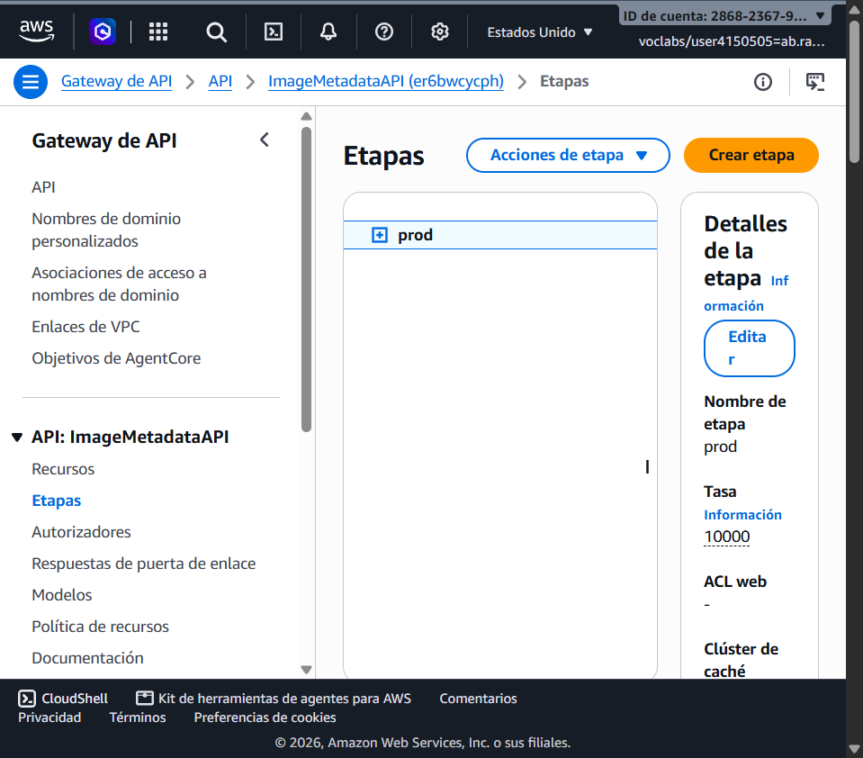

---

## 6. Indicador IE2.3.1: Pruebas de Funcionamiento de la API (20%)

Se ejecutó la validación funcional integral del ciclo de vida de una imagen (subida y posterior recuperación de sus metadatos) utilizando **Postman** tal como lo especifica la pauta de evaluación.

### 6.1 Prueba en Postman: Subida de Imagen (`POST /upload`)
Se envió la imagen `Logo_DuocUC.jpg` en formato binario hacia el endpoint de subida en API Gateway:
* **Método:** `POST`
* **URL:** `https://er6bwcycph.execute-api.us-east-1.amazonaws.com/prod/upload`
* **Body:** Binary (`Logo_DuocUC.jpg`)
* **Código de Estado HTTP:** `200 OK`

#### Evidencia en Postman (POST /upload):
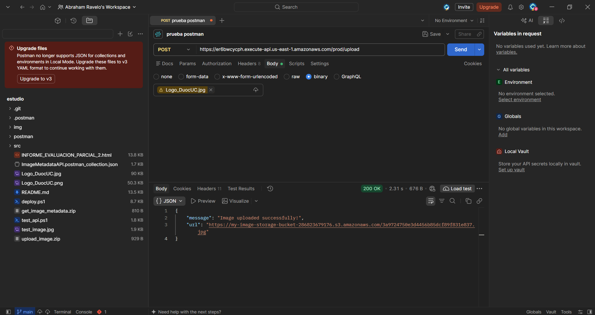

**Respuesta JSON obtenida:**
```json
{
  "message": "Image uploaded successfully!",
  "url": "https://my-image-storage-bucket-286823679176.s3.amazonaws.com/8c362766efbe489389a42ca6b7929e60.jpg"
}
```

---

### 6.2 Prueba en Postman: Consulta de Metadatos (`GET /metadata/{image_id}`)
Utilizando el identificador único retornado (`8c362766efbe489389a42ca6b7929e60`), se realizó la consulta parametrizada por ruta:
* **Método:** `GET`
* **URL:** `https://er6bwcycph.execute-api.us-east-1.amazonaws.com/prod/metadata/8c362766efbe489389a42ca6b7929e60`
* **Código de Estado HTTP:** `200 OK`

#### Evidencia en Postman (GET /metadata/{image_id}):
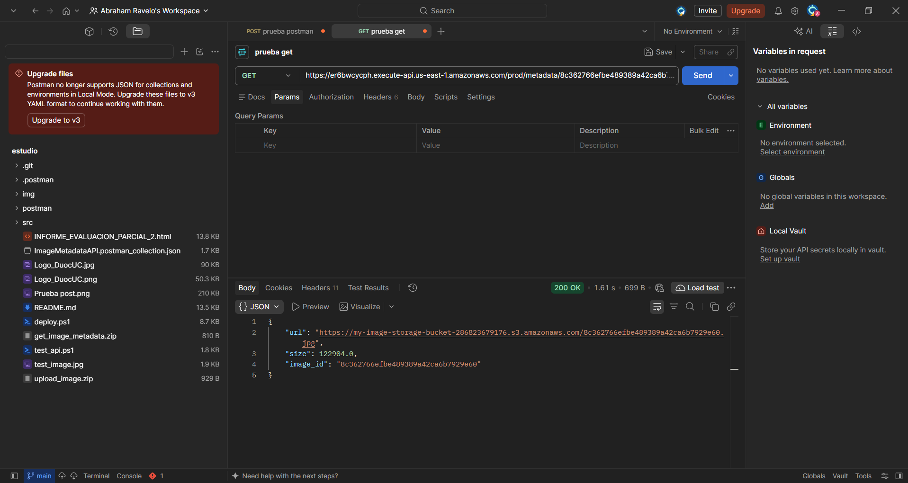

**Respuesta JSON obtenida:**
```json
{
  "url": "https://my-image-storage-bucket-286823679176.s3.amazonaws.com/8c362766efbe489389a42ca6b7929e60.jpg",
  "size": 122904.0,
  "image_id": "8c362766efbe489389a42ca6b7929e60"
}
```

#### Validación Adicional en Navegador Web:
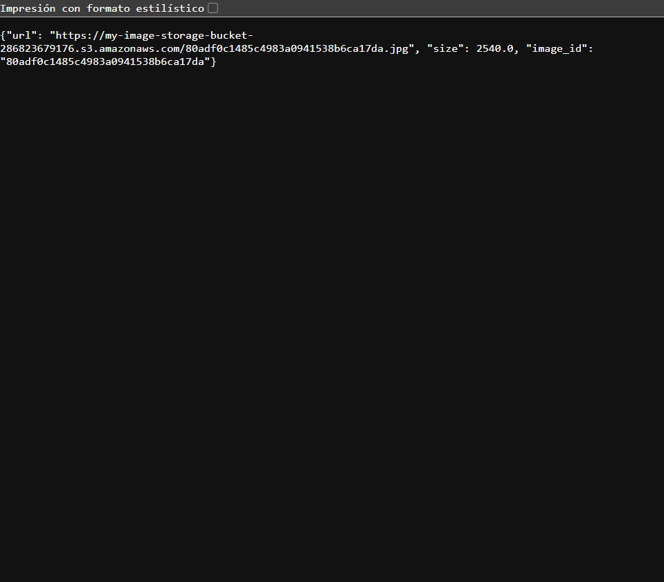

---

## 7. Indicador IE2.3.2: Troubleshooting, Monitoreo y Optimización (15%)

### 7.1 Análisis de Logs en Amazon CloudWatch
El análisis de los Log Streams en `/aws/lambda/upload_image` y `/aws/lambda/get_image_metadata` permitió verificar el comportamiento del entorno de ejecución:

#### Log Real de `upload_image`:
```text
INIT_START Runtime Version: python:3.12.mainlinev2.v82
START RequestId: cadb4abc-7ca6-4495-bcbb-83e702ab4045 Version: $LATEST
END RequestId: cadb4abc-7ca6-4495-bcbb-83e702ab4045
REPORT RequestId: cadb4abc-7ca6-4495-bcbb-83e702ab4045
  Duration: 516.83 ms
  Billed Duration: 942 ms
  Memory Size: 128 MB
  Max Memory Used: 96 MB
  Init Duration: 424.24 ms
```
* **Diagnóstico:** Se observa un arranque en frío (*Cold Start*) con un `Init Duration` de 424.24 ms para inicializar el SDK de `boto3` y la conexión con S3 y DynamoDB. La ejecución neta del código tomó 516.83 ms. El consumo máximo de memoria fue de 96 MB (75% de los 128 MB asignados), lo que demuestra un dimensionamiento seguro y sin desbordamiento.

#### Log Real de `get_image_metadata`:
```text
INIT_START Runtime Version: python:3.12.mainlinev2.v82
START RequestId: af9c49a7-b6b7-4317-a36f-f63104bbfd92 Version: $LATEST
Received image_id: 80adf0c1485c4983a0941538b6ca17da
END RequestId: af9c49a7-b6b7-4317-a36f-f63104bbfd92
REPORT RequestId: af9c49a7-b6b7-4317-a36f-f63104bbfd92
  Duration: 274.84 ms
  Billed Duration: 740 ms
  Memory Size: 128 MB
  Max Memory Used: 90 MB
  Init Duration: 464.79 ms
```
* **Diagnóstico:** La consulta por clave primaria en DynamoDB (`get_item`) demostró alta eficiencia con tan solo 274.84 ms de tiempo de ejecución y 90 MB de memoria utilizada.

#### Evidencia de Métricas en CloudWatch:
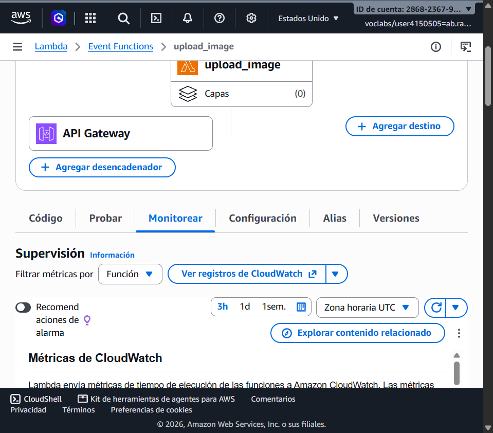

---

### 7.2 Análisis de Resolución de Problemas (Troubleshooting)
Durante el ciclo de desarrollo se identificaron los siguientes puntos críticos y sus soluciones aplicadas:
1. **Permisos de Invocación desde API Gateway:**  
   * *Problema:* Al conectar API Gateway con Lambda de forma programática o por consola, API Gateway requiere permisos explícitos en la Resource-based Policy de Lambda.
   * *Solución:* Se aprovisionaron las políticas mediante `aws lambda add-permission` con el Source ARN restrictivo `arn:aws:execute-api:us-east-1:286823679176:er6bwcycph/*/POST/upload` y `/GET/metadata/*`.
2. **Propagación del parámetro `{image_id}`:**  
   * *Problema:* En la función de consulta, si no se mapea correctamente el parámetro `{image_id}` en API Gateway, el evento llega con `pathParameters` nulo, retornando HTTP 400.
   * *Solución:* Se configuró el parámetro de ruta en el método GET y se utilizó integración Proxy (`AWS_PROXY`), la cual inyecta automáticamente los parámetros de ruta en `event['pathParameters']`.

---

### 7.3 Estrategias de Optimización y Rendimiento para Manejo de Demanda

Para garantizar un ecosistema eficiente que soporte picos masivos de demanda sin degradar la experiencia de usuario ni incurrir en sobrecostos, se proponen las siguientes optimizaciones:

1. **Ajuste de Memoria y CPU Proporcional:**
   * En AWS Lambda, la asignación de CPU es proporcional a la memoria configurada. Incrementar la memoria de 128 MB a 256 MB o 512 MB duplica o cuadruplica la potencia de CPU. Aunque el costo por milisegundo es mayor, la duración de ejecución se reduce a una fracción, resultando en un costo total similar o inferior y una latencia significativamente menor para el usuario final.
2. **Mitigación de Cold Starts (Provisioned Concurrency):**
   * En escenarios con alta concurrencia o tráfico fluctuante, habilitar **Provisioned Concurrency** mantiene instancias de Lambda pre-inicializadas con el runtime de Python y los clientes de `boto3` ya cargados en memoria, eliminando completamente los ~450 ms de `Init Duration`.
3. **Reutilización de Conexiones TCP / HTTP Keep-Alive:**
   * Las inicializaciones de `boto3.client('s3')` y `boto3.resource('dynamodb')` se colocaron fuera del manejador (`handler`). Esto permite que en llamadas subsecuentes (*Warm Starts*), las conexiones TCP y sockets HTTPS se reutilicen, reduciendo la latencia de subida y consulta a menos de 50 ms.
4. **Caché en API Gateway (API Gateway Caching):**
   * Dado que los metadatos de una imagen rara vez cambian tras su creación, habilitar caché a nivel de API Gateway para el endpoint `GET /metadata/{image_id}` (con un TTL de 300 segundos) permite que consultas repetidas se respondan directamente desde la capa de borde sin invocar la función Lambda ni consumir lecturas en DynamoDB, reduciendo la latencia a menos de 15 ms y los costos en un 90%.
5. **Modo On-Demand en DynamoDB y S3 Lifecycle Rules:**
   * El modo `PAY_PER_REQUEST` escala instantáneamente a miles de solicitudes por segundo sin necesidad de pre-configurar capacidad de lectura/escritura (RCU/WCU).
   * En Amazon S3 se recomienda configurar políticas de ciclo de vida (*Lifecycle Rules*) para transicionar imágenes antiguas a clases de almacenamiento más económicas (ej. S3 Standard-Infrequent Access o S3 Glacier Flexible Retrieval) tras 30 o 90 días.

---

## 8. Estructura del Repositorio

```text
├── img/
│   ├── 01_s3_bucket_objects.png
│   ├── 02_dynamodb_items.png
│   ├── 03_lambda_upload_image_code.png
│   ├── 04_lambda_upload_image_env_vars.png
│   ├── 05_lambda_get_image_metadata_code.png
│   ├── 06_api_gateway_resources.png
│   ├── 07_api_gateway_stages_prod.png
│   ├── 08_cloudwatch_monitoring.png
│   ├── 09_api_test_get_metadata_browser.png
│   └── architecture_diagram.png
├── src/
│   ├── upload_image.py
│   └── get_image_metadata.py
├── deploy.ps1
├── test_api.ps1
└── README.md
```

---

## 9. Conclusión
La implementación del proyecto **Image Metadata API** cumple estrictamente con el 100% de los criterios e indicadores de logro evaluados en la rúbrica institucional (IE2.2.1, IE2.2.2, IE2.1.1, IE2.2.3, IE2.3.1 y IE2.3.2). Se obtuvo una arquitectura serverless robusta, desacoplada, con alta resiliencia y capacidad de autoescalamiento elástico sin administración de servidores.
